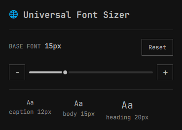

# Universal Font Sizer

Resize Omarchy shell, GTK, and terminal text independently from one bar
widget, with sliders, +/− steppers, live values, and reset controls.



## What it does

- Click the **🌐** indicator in your bar to open a panel with three
  independent controls, each with its own slider, +/− steppers and reset:
  - **Shell** base size (8–32px). Every other shell size (titles, captions,
    icons, bar height) scales off this value, so it resizes the bar and
    panels together.
  - **GTK** interface font (6–30pt), set as `text-scaling-factor`.
  - **Terminal** font (6–24pt) for alacritty, kitty, ghostty or foot.
- A live preview shows caption/body/heading sizes for the shell value.
- Each target can be reset independently; **Reset all** restores every
  target to its default.
- Current values are read from the system on open, so the panel always
  matches reality.
- Scrolling over the indicator nudges the shell size.

## Helper script

All writes go through `scripts/font-size-ctl`, which can also be used from a
terminal:

```bash
scripts/font-size-ctl get
scripts/font-size-ctl set --shell 14 --gtk 12 --term 10
scripts/font-size-ctl reset [shell|gtk|term|all]
```

`set` accepts one or more targets in the same command. Values must be whole
numbers inside the ranges shown in the panel. `get` prints machine-readable
`key=value` lines used by the widget to refresh its state.

## Requirements

[Omarchy](https://omarchy.org/) with the Quattro shell and `omarchy` CLI on
`PATH`. The helper uses standard utilities shipped with Omarchy, including
`gsettings`, `awk`, `sed`, and `grep`.

## Privilege boundary

Runs with your normal user permissions, same as the shell itself, and does
not request elevated capabilities. It runs only `scripts/font-size-ctl`,
which writes:

- `~/.config/omarchy/shell.toml` (`[font] base-size`)
- GTK `org.gnome.desktop.interface` `text-scaling-factor` (via `gsettings`)
- the terminal config for alacritty, kitty, ghostty or foot, then sends that
  terminal a reload signal (`pkill -USR1 kitty`, `pkill -SIGUSR2 ghostty`) or
  a desktop notification (foot)

The plugin makes no network requests and collects or sends no data.

## Install

```bash
omarchy plugin add https://github.com/ukkit/omarchy-universal-font-sizer --enable
```

## Local development

Files under `~/.config/omarchy/plugins/` normally hot-reload when saved. To
force a clean reload and validate the plugin after making changes:

```bash
omarchy restart shell
omarchy plugin validate ~/.config/omarchy/plugins/io.github.ukkit.universal-font-sizer
```

The helper can be syntax-checked separately:

```bash
bash -n scripts/font-size-ctl
```

## Remove

```bash
omarchy plugin remove io.github.ukkit.universal-font-sizer
```

## License

MIT — see [LICENSE](LICENSE). No third-party code is bundled.
